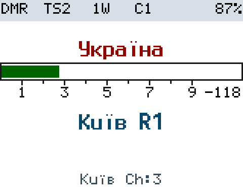
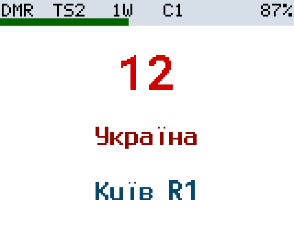
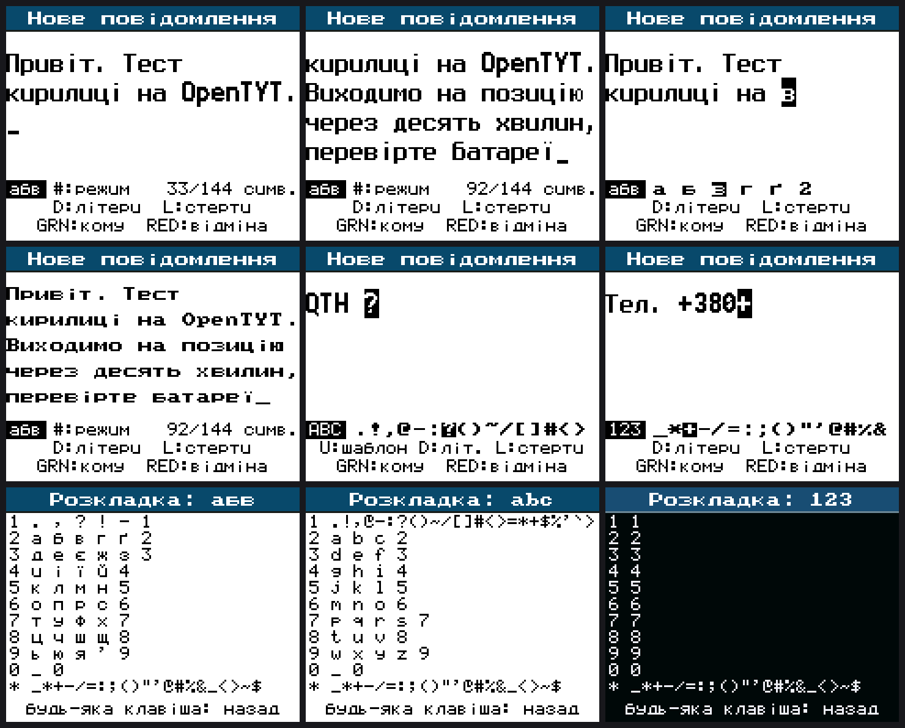
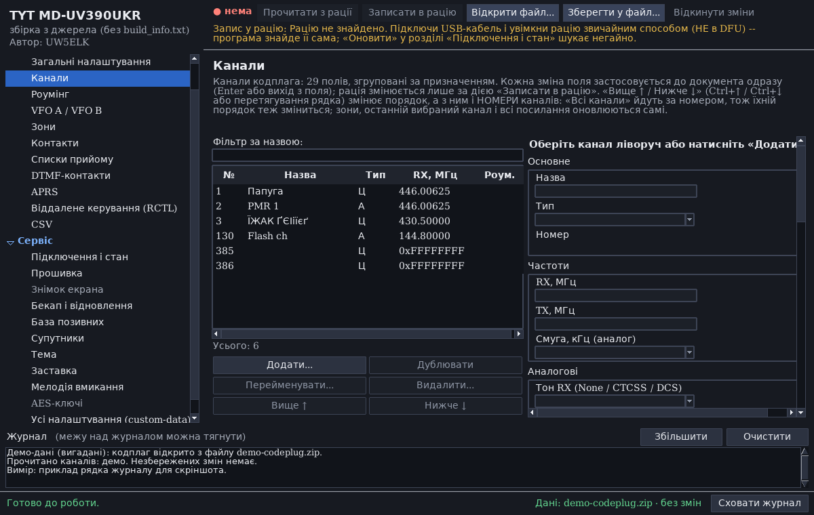
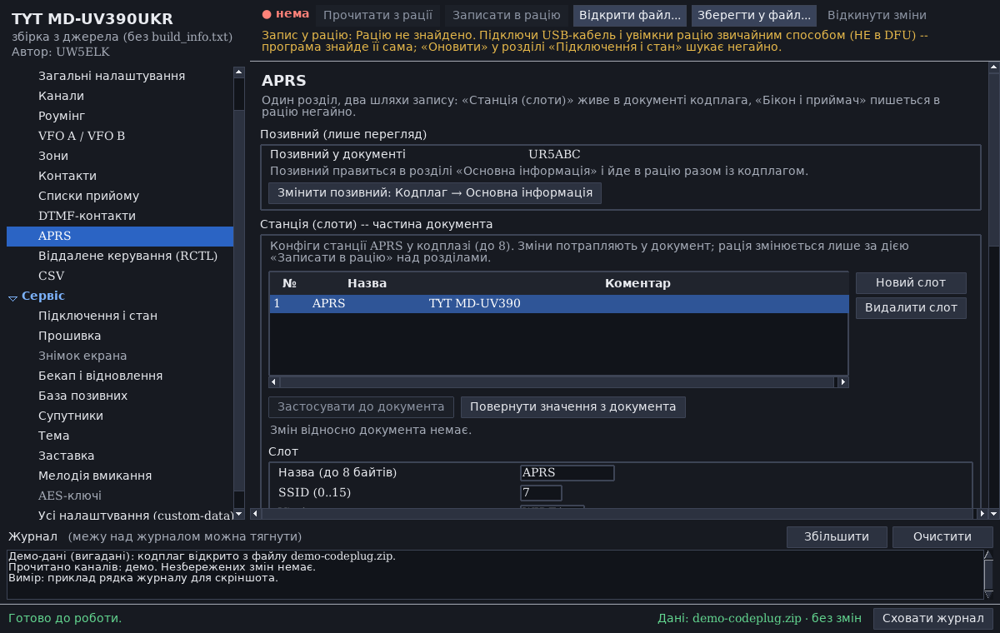
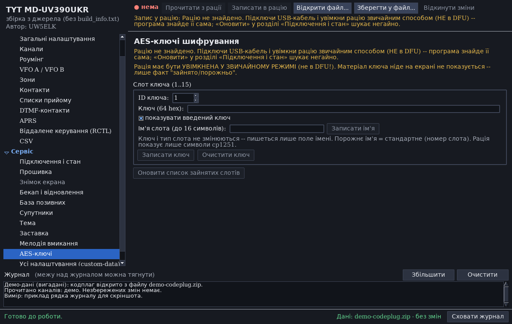
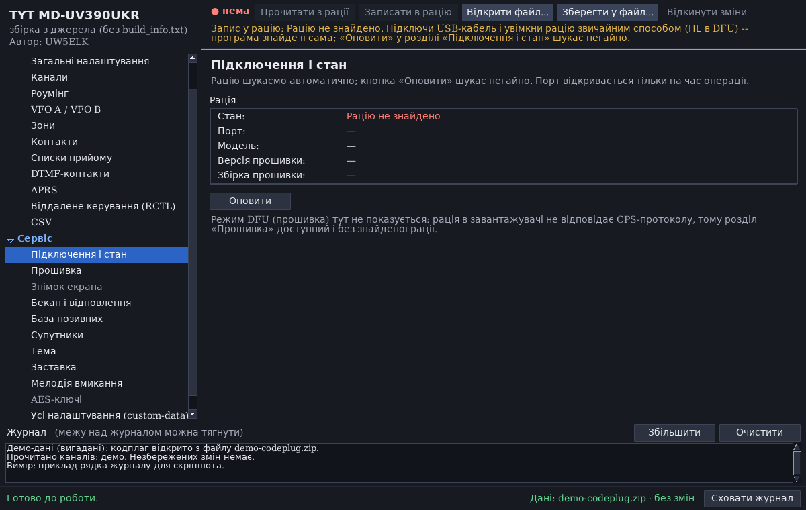
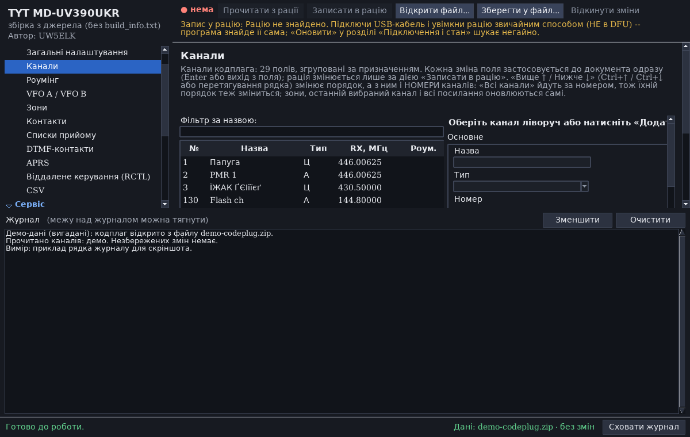

# OpenTYT — OpenGD77-AES256 для TYT MD-UV390 Plus (10W)

[](https://github.com/uw5elk/OpenTYT/actions/workflows/build.yml)
[](https://github.com/uw5elk/OpenTYT/releases)

> **⚠️ Експериментальний форк, не офіційний апстрім.** Це проєкт реверс-інжинірингу й сумісності для власного
> парку рацій; він **не є** офіційним релізом OpenGD77 і не підтримується його авторами.
> Прошивка й CPS пишуть у флеш-пам'ять рації; запис не захищений від втрати живлення (сектор 4 КіБ стирається
> і пишеться заново). **Пишіть у рацію лише після резервної копії кодплага: зробіть її перед першою прошивкою і
> перед кожним записом із CPS.**
> Більшість можливостей, доданих після зашифрованого голосу й SMS, **ще не перевірені на реальній рації** —
> див. [«Що перевірено, а що ні»](#що-перевірено-а-що-ні).
> Використання — лише на власних раціях і в межах ліцензій на частоти; проєкт не призначений для обходу чужого шифрування.

Зміст:
[Що це](#що-це) · [Можливості](#можливості) · [CPS](#cps-tytmd-uv390ukrexe) · [Встановлення](#встановлення) ·
[Збірка](#збірка) · [Структура репозиторію](#структура-репозиторію) · [Що перевірено, а що ні](#що-перевірено-а-що-ні) ·
[Юридичне](#юридичний-аспект) · [Ліцензія](#ліцензія) · [Подяки](#подяки)

Шляхи виду `tools/…` у цьому файлі — відносно `MDUV380_firmware/`.

## Що це

Форк [OpenGD77](https://opengd77.com) для **TYT MD-UV390 Plus (10W)** (STM32F405, `PLATFORM_MDUV380` +
`PLATFORM_VARIANT_UV380_PLUS_10W`, ціль `MDUV380_10W_PLUS_FW`), побудований на офіційному релізі вихідного коду
OpenGD77 **R20260131**. Додає:

- **AES-256 шифрування голосу** за схемою DMR Association (як у режимі «Universal» стокової прошивки TYT) —
  статус сумісності див. нижче, він **неоднозначний**;
- шифровані й відкриті **SMS** із кирилицею, **RCTL** (Radio Check тощо) у стоковому форматі TYT;
- **APRS** (прийом, повідомлення, маяк, піктограми), **роумінг** за списками, **редагування кодплага з рації**,
  «Мін.гучність», тон передачі супутників, українізацію;
- Windows-програму **CPS** `TYT.MD-UV390UKR.exe` для читання/запису кодплага, ключів AES, тем, заставки тощо.

Уся звичайна функціональність OpenGD77 (прийом/передача DMR/FM, hotspot тощо) не змінена. Усе нове
компілюється лише під окремими прапорцями `ENABLE_*` (див. [Збірка](#збірка)); **збірка без жодних прапорців
побайтово збігається зі стоковим OpenGD77.**

## Можливості

Колонка «На залізі» — за `STATUS.md` і `RELEASE_NOTES.md`: **так** — є запис про перевірку на реальній рації;
**ні** — такого запису нема (хостові тести й CI це не замінюють). Деталі й дати — у `STATUS.md`
(розділ «Зроблено й перевірено на залізі» та записи R-номерів) і кроки перевірки в `TESTING.md`.

| Можливість | Прапорець / де в меню / CPS | На залізі | Деталі |
|---|---|---|---|
| **AES-256** (сумісність із TYT «Universal», ключі) | `ENABLE_AES`; вибір ключа в каналі; CPS «Сервіс → AES-ключі» | **неоднозначно:** раніше фіксувалось успішне шифрування (старий опис проєкту), але польові виміри 2026-10-17 показали, що «наша → стокова» не розшифровується, а «стокова → наша» працює 5–20 с; після R64–R67 не підтверджено | `STATUS.md` (AES-fix1…6), `USAGE.md` §8, [розділ нижче](#aes-256) |
| Імена слотів ключів AES | `ENABLE_AES_KEY_NAMES`; `#` у списку ключів; CPS | ні | `STATUS.md` R64C |
| **SMS** (шифровані/відкриті, підтверджені CONFIRMED rate-3/4, кирилиця) | `ENABLE_AES` + `ENABLE_DMR_DATA`; меню «SMS DMR» (до R82 «Повідомлення») | **так** — CONFIRMED SMS, 2026-10-05; окремих відміток для підпунктів інтерфейсу (час, банер, набір кирилицею) нема | `STATUS.md`, `USAGE.md` §9 |
| **RCTL** (стоковий формат TYT) | окремого `ENABLE_*` у `Makefile` нема; меню «Доступ RCTL»; CPS «Дані → Віддалене керування (RCTL)» | **так** — Radio Check і 4 команди в обидва боки (2026-09-11/12); Call Alert — ні | `RCTL_COMPAT.md`, `USAGE.md` §10 |
| **«Переслухати»** (буфер останніх ~30 с прийнятого DMR-голосу) | `ENABLE_CALL_REPLAY`; пункт після «Останні виклики» | ні | `STATUS.md` («MVP «Переслухати»»), `docs/recording-feasibility.md` |
| **APRS** — прийом, список станцій, «Режим APRS», повідомлення, маяк, вікно маяка, піктограми (170), слоти станцій, «Джерело: Слот/Рація» | `ENABLE_APRS_RX` (лише українська збірка); меню «APRS»; CPS «Дані → APRS» | **частково:** прийом APRS і усунення зависання маяка підтверджені (STATUS, R12); повідомлення, вікно маяка, піктограми, слоти, «Джерело: Слот/Рація» — ні | `STATUS.md` (R8–R19, R69–R70), `docs/aprs-icons.md`, `docs/aprs-rx-feasibility.md` |
| **Роумінг** за списками (10 списків; перехід на наступний канал, коли ретранслятор не відповів на пробудження) | `ENABLE_ROAM_RETRY`; пункт «Роумінг», «Деталі каналу → Роум.список»; CPS «Дані → Роумінг» | ні | `STATUS.md` (R59–R61, R64B, R67A) |
| **Редагування з рації:** зони (перейменування, додати/вийняти канал, нова/видалити), канали, контакти, списки прийому, імена, переміщення | `ENABLE_ZONE_RENAME`, `ENABLE_ZONE_EDIT`, `ENABLE_CHANNEL_DELETE`, `ENABLE_CODEPLUG_MENU`, `ENABLE_RXGROUP_EDIT`; розділи «Зона», «Канали», «Контакти», «Списки прийому» | ні | `STATUS.md` (R41–R44, R65B, R66C) |
| **Подвійний прийом** (по черзі дві картки: A — канал або VFO, з якого ввімкнули; B — канал будь-якої зони або VFO A/B; вхід і вихід не змінюють канал/VFO; обрана картка — смуга кольору виділення ліворуч (без ▶); картка в 4 рядки з одним лівим краєм (без літер A/B: верхня — A, нижня — B; між картками одна лінія): повна назва 8x16, абонент/призначення (FM — лише частота), номер каналу + TS/CC/ТГ цілком або тони, RX/TX-мітка без заливки + S-метр (неактивна: DMR — RX-частота зі знаком «+»/«-» зсуву, FM/VFO — TX-частота лише коли вона інша), праворуч режим і потужність та замок; конверти «A ✉ N» (APRS) і «D ✉ N» (SMS DMR) — загальні, у шапці; SMS приймаються й у режимі — картка тримається на час обміну даними й квитанції; під час виклику — відстань і стрілка; керування: ручка — канали (на картці VFO — частота), червона — канал ↔ VFO картки, SK1 + ручка — шумодав/ТГ, SK2 + ручка — зона/крок; PTT з ТГ картки; довге ▼ вмикає/вимикає; стоковий «Dual Watch» VFO запускає цей режим; роумінг по списку працює й у режимі) | `ENABLE_DUAL_CHANNEL`; швидке меню каналу «Подв. прийом», меню VFO «Dual Watch»; custom-data блок 18 | ні | `STATUS.md` (R97–R98-FIX13), `USAGE.md` 6.1 |
| Затримка відкриття шумодава FM | `ENABLE_SQL_OPEN_DELAY`; «Звук → Затр.шуму» (з R81; раніше «Опції рації») | ні | `STATUS.md` (R42) |
| Відстань і азимут до кореспондента за координатами в його Talker Alias / GPS-блоці (LC 0x08): у шапці виклику замість квадрата Maidenhead, коли задана ВЛАСНА позиція («Параметри»): відстань текстом, напрям «навігаційним наконечником» (R92/R93; не ближче 50 м; та сама форма в екрані APRS, голці сповіщення й передпоказі CPS), у т.ч. для імен з кодплагу/бази DMR ID | `ENABLE_LC_DISTANCE` (діє разом з `ENABLE_APRS_RX`); окремого пункту меню нема | **ні** — лише хост-тести з синтетичними даними; потрібна друга рація з нашою/OpenGD77 прошивкою у TX Talker Alias «APRS»/«Обидва» | `STATUS.md` (R91C, R92), `TESTING.md` блоки EE, EF, EG |
| **Тон передачі супутників** (перерахунок при зміні набору частот 1/2/3) | `ENABLE_SAT_TONE_SYNC` | ні | `STATUS.md` (R66D) |
| **«Мін.гучність»** (постійний тихий нижній рівень; з R81 завжди ввімкнено, з R98-FIX7 коліно 32 позиції ручки (було 16), пункту меню немає) | `ENABLE_VOLUME_LOW` | ні | `STATUS.md` (R78, R81) |
| **Українізація** (кириличний шрифт, `ukrainian.h`) | `LANGUAGE_UKRAINIAN=1`; кирилиця в назвах кодплага (R23) | частково: гліф «ю» перевірено (партія правок 2026-09-11); решта — ні | `STATUS.md`, `USAGE.md` |
| **Швидке меню каналу без стокового «Roaming»** (пункти GPS приховано; з R94Б ефективний режим GPS в українській збірці завжди Off; рядок «Talkaround» називається «Без репітера») | `FORK_NO_GPS_MENU` (у коді), без зсуву нумерації | пункти GPS у меню прибрано — **так** (2026-09-11); «Roaming» у швидкому меню, «Без репітера» (R94А) і «ефективний Off» (R94Б) — ні (R74, R94) | `STATUS.md` (R74, партія правок 2026-09-11) |
| **Діагностика й обробник збою** (HardFault/сторож показує адресу; `.map`/`.elf` у релізі `ci-<хеш>`; `tools/fault_lookup.py`) | під `ENABLE_APRS_RX`; діагностичні `ENABLE_*` (див. нижче) | ні | `STATUS.md` (R10-fix4, R10-fix6) |
| Фіксація PTT на каналах без TOT (таймаут 120 с), порожні зони пропускаються, вікно гучності, годинник + заряд | без окремих прапорців (партія правок 2026-09-11) | **так** | `STATUS.md` («Партія правок з фідбеку fleet») |
| Лінкер: `.rodata` після кодека (дало місце для нових функцій) | `ENABLE_RODATA_AFTER_CODEC` | тестова збірка (блок DJ, R63C): старт, меню, цифровий голос — **так**; AES у ній не підтверджено | `STATUS.md` (R64A), `RELEASE_NOTES.md` |

### Назви пунктів меню (українська збірка)

Підписи, які власник вимагав перекласти (R82, R94): **SMS DMR** (було «Повідомлення»), **Роумінг**, **Захист кан.** (було «Ch. blocked»), **Супутник** (було «SAT»), **Кор.темп.** / **Кор. акум.** (R96; у R82 були «Калібр. темп./акум.», що з'їдало місце значення), **Хвіст VOX**, **Ключі AES** (заголовок екрана), **Без репітера** (швидке меню каналу, було «Talkaround»). Прибрано з меню: «Мін.гучн.», «Гучність», «Показ відст.», «GPS». «Про прошивку» — останній пункт «Налаштувань»; «Опції теми» — в «Дисплей»; «Затр.шуму» — у «Звук». Докладно — `docs/menu-reference.md`, `USAGE.md` (§3.3, §4.1–4.2), калібрування — `docs/calibration.md`. На залізі переклад не перевірявся (`TESTING.md`, блоки EH, EI).

<!-- TODO: фото docs/img/radio-photo-channel.png — екран каналу на реальній рації -->
<!-- TODO: фото docs/img/radio-photo-aprs-menu.png — меню «APRS» -->
<!-- TODO: фото docs/img/radio-photo-aprs-beacon-window.png — вікно маяка -->
<!-- TODO: фото docs/img/radio-photo-volume-low.png — «Мін.гучність» (пункту меню вже немає: з R81 функція завжди ввімкнена) -->
<!-- TODO: фото docs/img/radio-photo-roam-list.png — «Деталі каналу → Роум.список» -->
<!-- TODO: фото docs/img/radio-photo-quick-menu.png — швидке меню каналу (без «Roaming») -->
<!-- TODO: фото docs/img/radio-photo-sms.png — екран SMS (вхідне / набір) -->
<!-- TODO: фото docs/img/radio-photo-tx-red.png — червоний екран передачі -->

### Екрани рації

Справжніх фотографій екрана рації в репозиторії поки нема (див. TODO-коментарі вище). Нижче — **не фото, а
рендери** проєктними засобами (`tools/screen_views.py`, `tools/render_sms_compose.py`): шрифти, кольори теми й
координати взято з коду прошивки, а **дані на екрані — прикладові (вигадані)**. Екранів форка без власного
рендерера (APRS, «Мін.гучність», «Роум.список» тощо) тут свідомо немає.

| Канал (рендер) | Передача (рендер) |
|---|---|
|  |  |



### AES-256

Реалізує стандартизовану схему **DMR Association AES-256** (ETSI TS 102 361, сумісну з Motorola/Hytera), яку
використовує режим «Universal» MD-UV390 Plus:

- **AES-256 у режимі OFB**, потік ключа накладається (XOR) на декодовані 49-бітові параметри голосу AMBE;
- 32-бітовий **Message Indicator (MI)** з заголовка PI розширюється до 128-бітового IV через LFSR
  (`dmr_lfsr128d`) і просувається на один крок кожен суперфрейм;
- MI передається й **усередині бітів кодового слова AMBE** (Late-Entry MI, Golay(24,12)+CRC4); виклик
  анонсується в ефірі через LC зашифрованого виклику (FID `0x10` / SO `0x40`) і Late-Entry Single Block з EMB burst-F;
- **ключі** зберігаються постійно в області custom-data SPI-flash (переживають перезавантаження й перепрошивку)
  і записуються з CPS по USB або вводяться на рації; слотів ключів — 15.

**Чесний статус.** Раніше (старий опис проєкту) фіксувалось, що стокова рація розшифровує передачу форка й
навпаки. Пізніші польові виміри (`STATUS.md`, запис AES-fix1, 2026-10-17, збірка `aes`) показали, що
«наша → стокова» не розшифровується взагалі, а «стокова → наша» працює 5–20 с, далі спотворення; «наша ↔ наша»
працює. Подальші виправлення (AES-fix1…6) у `STATUS.md` позначені як **не перевірені на залізі**, а
`RELEASE_NOTES.md` прямо каже: шифрування на збірках після R64–R67 не підтверджено. **Не покладайтесь на
сумісність зі стоковою TYT, доки не пройдете кроки AES із `TESTING.md` на власних раціях.**

### Опційна діагностика

Діагностика розшифровки/потоку ключа AES і інші діагностичні екрани компілюються за прапорцями, вимкненими за
замовчуванням (`DMR_AES_DIAG_RX` / `DMR_AES_DIAG_PATTERN` / `DMR_AES_DIAG_ENCPAT`, `ENABLE_SMS_DIAG`,
`ENABLE_WAKE_DIAG`, `ENABLE_MEM_DIAG`, `ENABLE_APRS_RX_PROBE`, `ENABLE_VOLUME_PROBE`, `ENABLE_TA_DIAG` (R88: сирий Talker Alias і GPS-блок LC, окремий реліз `…-tadiag-<хеш>.bin`) та ін.). У користувацькі
збірки вони не входять. Читання по USB — `tools/rxdiag.py`, `tools/fragcap.py`, `tools/mem_diag.py`.

## CPS (`TYT.MD-UV390UKR.exe`)

Windows-програма для роботи з кодплагом і налаштуваннями рації по USB. Джерело — пакет
`MDUV380_firmware/tools/cps_ui/` (Python + Tk; `.exe` збирає PyInstaller у CI). Покроковий опис — `USAGE.md`
(увага: частина `USAGE.md` застаріла, див. [нижче](#що-перевірено-а-що-ні)).

Що вміє (за `STATUS.md`, R75 і далі):

- **Документ = кодплаг + малі блоки налаштувань custom-data** (RCTL, шумодав APRS, стоковий бікон, роумінг).
  «Прочитати з рації» читає обидві частини; «Записати в рацію» — **один запис**: один діалог «що зміниться»,
  страхові копії (кодплаг — через `restore_codeplug`, налаштування — файл `customdata_pre-write_*.bin`),
  одне перезавантаження. Файл документа — `.zip` + `customdata.bin`.
- **Бекапи й відновлення** (розділ «Бекап і відновлення»), **автовиявлення рації** (лише дивиться у список
  портів ОС, порт не відкриває).
- Розділи «Дані»: загальні налаштування, канали, роумінг, VFO, зони, контакти, списки прийому,
  DTMF-контакти, APRS (станція-слоти й бікон), RCTL, CSV-обмін.
- Розділи «Сервіс»: підключення і стан, прошивка, знімок екрана, бекап, база позивних (DMR ID), супутники,
  тема, заставка, мелодія вмикання, **AES-ключі** (імена слотів, запис/очищення ключа; матеріал ключа на
  екрані не показується), «Усі налаштування (custom-data)».
- Розмір вікна, положення й межі панелей запам'ятовуються; діалоги зміннорозмірні. Висоту журналу змінюйте, перетягнувши
  межу між деревом і журналом (на межі — «хват» із крапок і курсор зміни розміру; подвійне клацання — типове положення;
  кнопок «Збільшити»/«Зменшити» немає).

| Головне вікно з документом | APRS: слоти станцій |
|---|---|
|  |  |

| Ключі AES (порожній стан, без ключів) | «Сервіс»: підключення і стан |
|---|---|
|  |  |



Скріншоти зроблено в Linux (Xvfb, шрифти DejaVu/Liberation, як у CI) на **вигаданих демо-даних**; у Windows
вигляд відрізняється шрифтами. Налаштування 125/150 % масштабу Windows на реальному екрані **не перевірялись**.

**Системні вимоги.** Windows (`.exe` збирається на `windows-latest`), USB-кабель програмування, для
прошивки — драйвер WinUSB для DFU (`0483:df11`), який ставиться раз через Zadig (`BUILD.md`).
Python і libusb у `.exe` вже вбудовані.

**Де взяти файл і як відрізнити версію.** У [Releases](https://github.com/uw5elk/OpenTYT/releases) —
теги `ci-<короткий хеш коміту>` (pre-release; CI лишає 5 найновіших). У релізі лежить `TYT.MD-UV390UKR.exe`
(на GitHub пробіл у назві стає крапкою), `.bin` прошивки, `.map` і `.elf` того ж коміту. Версія — коміт у
заголовку вікна CPS і в меню рації «Прошивка».

## Встановлення

1. **Резервна копія.** У CPS: «Бекап і відновлення» → збережіть кодплаг (і ключі AES, якщо потрібні) у файл.
   Збережіть також оригінальну прошивку, якщо хочете мати шлях назад до стокової.
2. Візьміть `TYT.MD-UV390UKR.exe` з останнього релізу `ci-<хеш>` (або з артефакту CI).
3. Потрібен **донор кодека AMBE** — `MD9600-CSV(2571V5)-V26.45.bin`. У `.exe` вбудована прошивка, але **донор
   не вбудований** (немає права на розповсюдження); кодек AMBE+2 — власність DVSI. Перевірити кандидата:
   `python3 tools/verify_codec_donor.py <файл.bin>`.
4. Переведіть рацію в режим DFU (SK1 + PTT при вмиканні; якщо вже стоїть OpenGD77 з підтримкою DMR-даних,
   програма сама переведе її в DFU). Один раз на комп'ютер — Zadig → драйвер WinUSB для `0483:df11`
   (запускати, коли рація вже в DFU).
5. У вікні CPS: «Обрати файл донора...» → «ПРОШИТИ». Після прошивки перевірте коміт у меню «Прошивка».
6. **Не прошивайте 5W-збірку в 10W-рацію.**

Прошивати можна і зі стокової прошивки TYT. Повернення до стокової — стоковим засобом TYT із збереженої вами
оригінальної прошивки; кодплаг відновлюється з резервної копії. Окремого інструмента повернення до стокової цей
проєкт не містить. Детально — `BUILD.md`, `USAGE.md`.

Порядок оновлення (з `RELEASE_NOTES.md`): спершу резервна копія кодплага → прошивка `.exe`/`.bin` →
перевірка коміту в меню «Прошивка».

## Збірка

Користувачу ARM-тулчейн локально **не потрібен**: готові збірки робить GitHub Actions
(`.github/workflows/build.yml`: `build-ukrainian` → реліз `ci-<хеш>`, `build-gui-flasher` → `.exe`). Для
самостійної збірки — `BUILD.md` (ARM GNU 14.2.Rel1, `make`), швидка перевірка синтаксису без тулчейна —
`tools/syntax_check.sh`.

```sh
cd MDUV380_firmware
make                       # типова збірка: байт-у-байт стоковий OpenGD77
make ENABLE_AES=1 -j$(nproc)
```

**Користувацька збірка CI** (`build-ukrainian`): `LANGUAGE_UKRAINIAN=1 ENABLE_AES=1 ENABLE_DMR_DATA=1
ENABLE_CALL_REPLAY=1 ENABLE_APRS_RX=1 ENABLE_CHANNEL_DELETE=1 ENABLE_SQL_OPEN_DELAY=1 ENABLE_ZONE_RENAME=1
ENABLE_ZONE_EDIT=1 ENABLE_CODEPLUG_MENU=1 ENABLE_ROAM_RETRY=1 ENABLE_AES_KEY_NAMES=1 ENABLE_RXGROUP_EDIT=1
ENABLE_SAT_TONE_SYNC=1 ENABLE_VOLUME_LOW=1 ENABLE_RODATA_AFTER_CODEC=1`.

Прапорці `Makefile` (за коментарями в самому `Makefile`; «У CI» — входить у користувацьку збірку):

| Прапорець | Що вмикає | Залежності / примітки | У CI |
|---|---|---|---|
| `ENABLE_AES` | AES-256 голосу, ключі | основа для SMS/RCTL-коду форка | так |
| `ENABLE_DMR_DATA` | дані DMR (SMS) | разом з `ENABLE_AES` | так |
| `LANGUAGE_UKRAINIAN` | українські рядки й шрифт | потрібен для більшості меню нижче | так |
| `ENABLE_CALL_REPLAY` | «Переслухати» | незалежний | так |
| `ENABLE_APRS_RX` | приймач APRS, меню «APRS», повідомлення | лише українська збірка; `APRS_TX_BW_25K=0` — маяк 12,5 кГц | так |
| `ENABLE_CHANNEL_DELETE` | «Видалити канал» | українська збірка | так |
| `ENABLE_SQL_OPEN_DELAY` | затримка відкриття шумодава FM | українська збірка | так |
| `ENABLE_ZONE_RENAME`, `ENABLE_ZONE_EDIT` | перейменування зон; додати/вийняти/нова/видалити зону | українська + `ENABLE_APRS_RX` | так |
| `ENABLE_CODEPLUG_MENU` | розділи «Зона / Канали / Контакти» в головному меню | потребує `ENABLE_CHANNEL_DELETE`, `ENABLE_ZONE_RENAME`, `ENABLE_ZONE_EDIT` | так |
| `ENABLE_ROAM_RETRY` | «Роумінг» за списками | типово вимкнено в самій рації | так |
| `ENABLE_AES_KEY_NAMES` | імена слотів ключів AES | потребує `ENABLE_AES`, multitap | так |
| `ENABLE_RXGROUP_EDIT` | редактор списків прийому | потребує `ENABLE_CODEPLUG_MENU`, українська | так |
| `ENABLE_SAT_TONE_SYNC` | тон передачі супутників | незалежний | так |
| `ENABLE_VOLUME_LOW` | «Мін.гучність» (з R81 -- без налаштування; R98-FIX7: K = 32) | лише українська збірка UV380 Plus 10W | так |
| `ENABLE_RODATA_AFTER_CODEC` | `.rodata` після кодека (інший лінкер-скрипт) | без прапорця `.bin` той самий | так |
| `ENABLE_APRS_IWDG` | апаратний сторож для «Режиму APRS» | лише лабораторна перевірка; типово вимкнено | ні |
| `ENABLE_SMS_DIAG`, `ENABLE_WAKE_DIAG`, `ENABLE_MEM_DIAG`, `ENABLE_APRS_RX_PROBE`, `ENABLE_VOLUME_PROBE`, `DMR_AES_DIAG_*` | діагностика (екрани «Діагностика», журнал пробудження, проби) | `ENABLE_SMS_DIAG` і `ENABLE_WAKE_DIAG` потребують `ENABLE_AES` + `ENABLE_DMR_DATA`; не для користувацьких збірок | ні (окремі джоби) |
| `ENABLE_KEY_INJECTION`, `ENABLE_SPECTRUM`, `ENABLE_SCAN_PROFILER`, `ENABLE_FAST_SCAN` | розробницькі інструменти / швидке аналогове сканування | `ENABLE_SCAN_PROFILER` потребує `ENABLE_SPECTRUM`; `ENABLE_KEY_INJECTION` і `ENABLE_SPECTRUM` — лише dev, у релізах не вмикати | ні |

Числа пам'яті (RAM/CCM/флеш, запас до кодека) змінюються від коміту до коміту й **не наводяться тут**:
їх друкує CI (`tools/mem_report.py`), останні виміряні значення для релізу — у `RELEASE_NOTES.md` і `STATUS.md`.

Для DMR потрібен пропрієтарний вокодер AMBE+2, якого немає в жодному OpenGD77; завантажувач вбудовує його з
донора під час прошивки (`BUILD.md`).

## Структура репозиторію

| Шлях | Що там |
|---|---|
| `MDUV380_firmware/` | вихідний код прошивки (`application/`, `Core/`, `Drivers/`, `Middlewares/`), `Makefile` |
| `MDUV380_firmware/tools/` | CPS (`cps_ui/`), прошивальник, USB-утиліти, перевірки (`syntax_check.sh`, `check_*.py`), рендерери екранів, тести Python |
| `MDUV380_firmware/tests/` | хостові тести C і `run_tests.sh` (запускає всі тести, у т.ч. Python/Tk під xvfb) |
| `docs/` | розвідки й формати (`aprs-icons.md`, `aprs-rx-feasibility.md`, `cps-protocol.md`, `codeplug-encoding.md`, `cps-csv.md`, `menu-reference.md`, `calibration.md` (калібрування, R94), `codec-margin-investigation.md` (запас до кодека, R94), …); `docs/img/` — зображення цього README |
| `.github/workflows/build.yml` | CI: перевірки, збірки, реліз `ci-<хеш>`, `.exe` |
| `STATUS.md` | що зроблено, що перевірено на залізі, що ні (розділ «Зроблено й перевірено на залізі» — підтверджене) |
| `TESTING.md` | кроки ручної перевірки на залізі й Windows (блоки за літерами) |
| `BUILD.md`, `USAGE.md`, `RCTL_COMPAT.md`, `RELEASE_NOTES.md`, `PLANS.md` | збірка/прошивка, посібник, сумісність RCTL, примітки релізу, плани |

## Що перевірено, а що ні

- **Підтверджено на залізі (за `STATUS.md`):** CONFIRMED SMS (2026-10-05); RCTL — Radio Check і 4 команди в обидва
  боки (2026-09-11/12); прийом APRS і усунення зависання маяка (R12); партія правок fleet 2026-09-11 (фіксація PTT,
  порожні зони, вікно гучності, годинник+заряд, прибрані пункти GPS, список ключів AES, гліф «ю»); тестова
  збірка з `.rodata` після кодека (блок DJ, R63C).
- **AES-256:** статус неоднозначний, див. [розділ AES](#aes-256); після R64–R67 не підтверджено.
- **Не перевірено на залізі:** роумінг, редагування зон/каналів/контактів/списків прийому з рації, імена ключів,
  «Переслухати», повідомлення/вікно маяка/піктограми APRS, тон супутників, «Мін.гучність», швидке меню без
  «Roaming», обробник збою; весь CPS на Windows (запуск, 125/150 % масштаб, запис у рацію з нового вікна).
- **`USAGE.md`** містить застарілі твердження (зокрема «RCTL на залізі не перевірявся»), яких `STATUS.md` не
  підтверджує; при розбіжності вірте `STATUS.md`.
- **Відомі обмеження** (`RELEASE_NOTES.md`): запис у флеш не захищений від втрати живлення; переміщення каналу
  на межі сектора 4 КіБ відхиляється; тривалість видалення списку прийому з багатьма каналами не виміряна.

Зображення в `docs/img/` не містять справжніх DMR ID, координат чи ключів AES (демо-дані). Перевірка, що
відносні посилання й зображення в README не зламані, — `tools/check_readme_links.py` (входить у
`tests/run_tests.sh`).

## Юридичний аспект

Зашифрований голос AES-256 **заборонений на аматорських діапазонах у більшості країн**; він законний лише на
ліцензованих комерційних/PMR-частотах. Використовуйте це лише там, де маєте ліцензію на передачу
зашифрованого голосу, і лише на **власних раціях**. Проєкт не призначений для обходу чужого шифрування. Вихідний
код і бінарники теж **лише для некомерційного використання** — див. [`license.txt`](license.txt).

## Ліцензія

Цей форк успадковує ліцензію OpenGD77 — **у стилі BSD-3-clause з пунктом про некомерційність** (пункт 4:
використання вихідного коду чи бінарних релізів у комерційних цілях суворо заборонене). Повний текст —
[`license.txt`](license.txt) (Copyright (C) 2019-2024 OpenGD77 firmware developers). Усі файли й заголовки
авторських прав апстріму збережені. Кодек AMBE+2 — власність DVSI, у прошивці його нема.

## Подяки

OpenGD77 задумав Kai DG4KLU, розробляв Roger Clark VK3KYY, пізніше долучились Daniel F1RMB, Alex DL4LEX,
Colin G4EML та багато інших (провідний розробник / хранитель вихідного коду: Roger VK3KYY) — повний список
учасників дивіться в проєкті-апстрімі. Цей форк лише додає шар DMRA AES-256 та інші можливості поверх їхньої
роботи. Еталонна реалізація схеми DMRA AES — [DSD-FME](https://github.com/lwvmobile/dsd-fme) від lwvmobile.

Посібник користувача (загальна робота з OpenGD77): https://github.com/LibreDMR/OpenGD77_UserGuide

Автор форку: UW5ELK.
